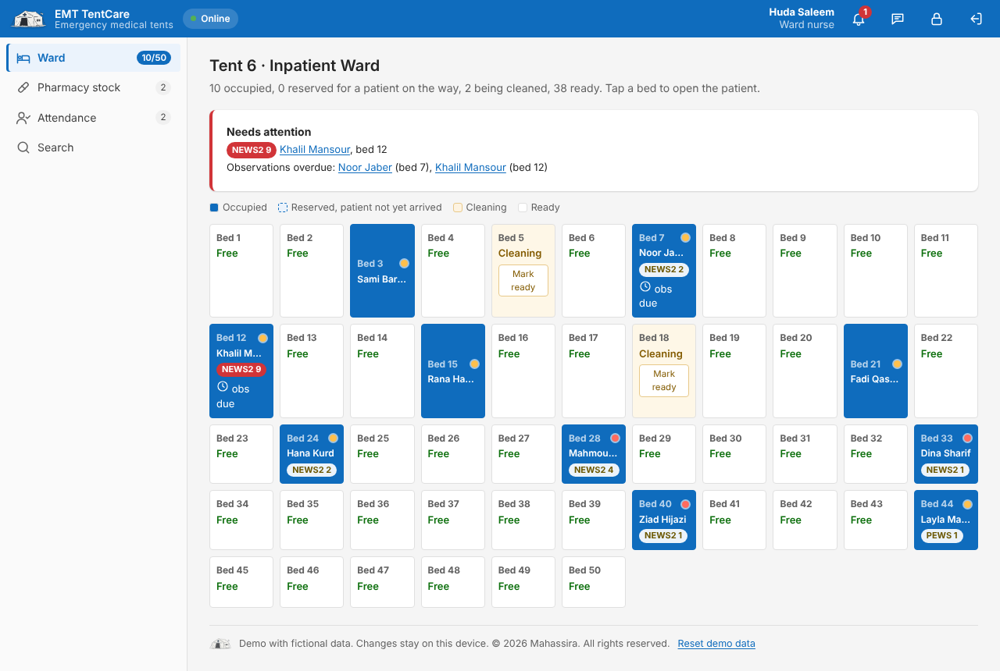
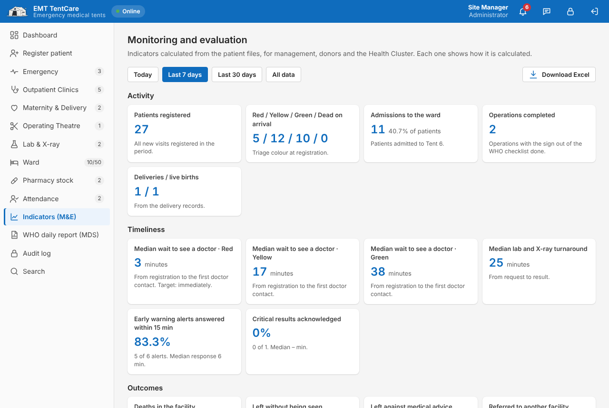
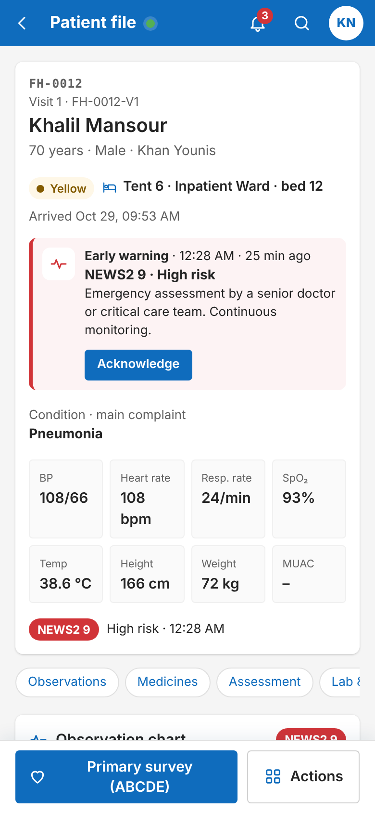
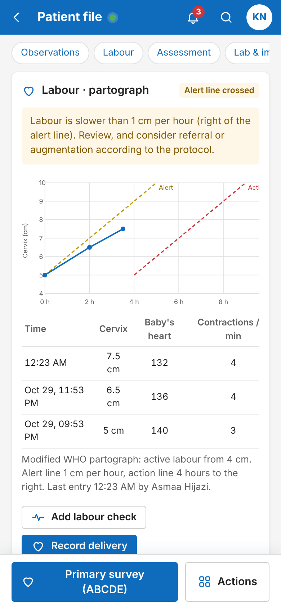

<p align="center"></p>

<h1 align="center">EMT TentCare</h1>

<p align="center">
  Patient flow for a six-tent emergency field hospital, built to keep working when the internet doesn't.<br>
  <a href="https://mahassira.github.io/emergency-field-hospital/"><b>Live demo</b></a> ·
  <a href="docs/EMT-TentCare-User-Guide.pdf">User guide (PDF)</a> ·
  <a href="CHANGELOG.md">Changelog</a>
</p>

---

## Why I built this

I worked with International Medical Corps (IMC) at its field hospital in Gaza, which first opened in January 2024. In the first days of any field hospital the same problems come back: paper files get lost between tents, doctors don't know if a result is back, nobody can say how many ward beds are free, managers count patients by hand for donors and the Health Cluster, and the internet keeps dropping.

Field hospitals will keep being set up in emergencies and conflict zones, often within days and with weak or no internet. They need a system that is ready on day one, works online and offline, and is prepared before the crisis rather than built during it. A ready system also gives donors and management the numbers they ask for, without extra work for the clinical team.

EMT TentCare is a working demo of that system: one patient file that follows the person from the registration tent to the ward, and a clear picture of the whole hospital for the site manager.

### Which kind of field hospital

The layout (registration and triage, emergency, outpatients, maternity, an operating theatre and a 50-bed ward) matches a WHO **Emergency Medical Team Type 2**: inpatient acute care, general and obstetric surgery, at least 20 beds and one operating theatre, open 24 hours a day ([WHO, 2021](https://www.who.int/publications/i/item/9789240029330)). With an intensive care unit it can serve a **Type 3** referral hospital, and **Type 1** outpatient teams can use the registration, triage and outpatient parts.


## Try the demo

Open the [live demo](https://mahassira.github.io/emergency-field-hospital/) and sign in with any of these accounts. The password for all of them is `demo123`.

| Work email | Role | What to try |
| --- | --- | --- |
| `reception@emttentcare.com` | Registration clerk | Register a patient, use the WHO triage criteria, start mass casualty mode |
| `doctor@emttentcare.com` | Doctor | Early warning alerts, prescribing, WHO surgical checklist, partograph and delivery, referral, discharge |
| `lab@emttentcare.com` | Lab & X-ray | Enter results, flag a critical result for the doctor |
| `nurse@emttentcare.com` | Ward nurse | Ward map with early warning scores, observation chart, give medicines, pharmacy stock |
| `admin@emttentcare.com` | Site manager | Dashboard, M&E indicators, WHO daily report (MDS), disease alerts, audit log, export to Excel |

All patients and staff are fictional. The demo saves everything on your own device and does not connect to any server. Please do not enter real patient data.

<p align="center"></p>

## What it does

**Registration and triage**
- One file per patient, with a file number (FH-0026) and a printable wristband.
- Allergy status (unknown, none known, or the allergy), vital signs with checks for impossible or unusual values.
- High-risk red signs and high-risk trauma from the WHO trauma form suggest the triage colour. Choosing a lower colour is recorded as clinical judgement.
- Returning patients keep their file number and get a new visit (FH-0004-V2).
- Mass casualty mode: three taps per patient, temporary IDs (MCI-001), a red banner for all staff, and "Identify patient" later, with a photo and clothes or marks to help.
- Children without a parent or caregiver are flagged to the child protection focal point.

**Patient safety**
- Early warning score on every set of vital signs: NEWS2 for adults, a simplified paediatric score for children. An observation chart shows the trend, and the next observation time.
- A medium or high score alerts the doctor. Alerts stay open until a doctor acknowledges them and writes the action taken, so the response time is measured.
- Prescribing with child doses calculated from the weight (WHO Pocket Book), maximum dose checks, allergy, pregnancy and interaction warnings. A child with no weight cannot be prescribed a weight-based dose.
- Medication chart: due and overdue doses, and a wristband identity check before every dose.
- Critical lab results go to the doctor as an alert that needs a read-back.
- Changing an assessment keeps the earlier version with the reason. Nothing is overwritten.

**Clinical care**
- Tent queues sorted by triage colour and waiting time.
- ABCDE primary survey with GCS, FAST and mechanism of injury.
- ICD-10 codes with search, which also suggest the WHO MDS item.
- Theatre: consent and the WHO Surgical Safety Checklist (sign in, time out, sign out). The team cannot go on while an item is not confirmed, and sign out needs the operation record.
- Maternity: partograph with alert and action lines, delivery record with PPH check, and a file for the newborn linked to the mother (weight, APGAR, essential newborn care).
- Nutrition: MUAC and oedema classify severe and moderate acute malnutrition and suggest the programme to refer to.
- Blood transfusion with a second checker and a blood group compatibility stop.
- Disease alerts (EWARN): suspected measles, cholera, meningitis and other priority diseases alert the site manager to report within 24 hours, and the patient is marked for isolation.
- Confidential protection record (GBV, violence, vulnerable child or adult), seen only by doctors and the site manager. Opening another doctor's record asks for a reason and is logged.
- Death record with immediate and underlying cause, following the WHO medical certificate of cause of death.

**Moving patients**
- Referral between tents needs the receiving tent to accept the patient.
- Ward admission reserves a bed until the nurse confirms arrival; beds go to cleaning after a patient leaves.
- Referral to another hospital in SBAR format with the 13-point WHO transfer checklist, a printable referral sheet, arrival status and counter-referral.
- Discharge in two steps: the doctor approves, the nurse or doctor confirms the patient has actually left.

**Management, monitoring and evaluation**
- Live dashboard, staff and patient attendance, follow-up visits.
- Indicators with their definitions: waiting times by triage colour, alert response times, mortality, caesarean and PPH rates, surgical checklist compliance, identity checks, MDS coding, bed occupancy.
- Daily report in the format of the WHO EMT Minimum Data Set (MDS), as Excel, CSV or a DHIS2 import file.
- Pharmacy stock that goes down with every dose, with low-stock and expiry alerts.
- Audit log of sign-ins, opened files, amendments and confidential records. The screen locks after 10 minutes without use.
- Excel export of everything, built in the browser so it works offline. Protection records are never exported.
- In-app feedback form for people trying the demo.

<p align="center"></p>

<p align="center"></p>

<p align="center"></p>

<p align="center"> &nbsp;  &nbsp; </p>

## Clinical forms

Scores, doses and checklists come from published sources (listed below). The early warning scores and child doses help staff; they do not replace clinical judgement. The referral, transfer and trauma forms follow the [WHO Emergency Care Toolkit](https://www.who.int/teams/integrated-health-services/clinical-services-and-systems/emergency-and-critical-care/emergency-care-toolkit). EMT TentCare is not an official WHO tool and is not endorsed by WHO or IMC. The triage rules and forms should be reviewed by an organisation's clinical leads before any real use.

## Works offline

The first time the link is opened, a service worker saves the app on the device. After that it opens and works with no connection, and it can be installed like an app (Add to Home Screen). In the demo, data stays in the browser on that device.

## The real version: Microsoft 365

<p align="center"></p>

The full version is designed to run entirely inside the organisation's own Microsoft 365 tenant. Nothing sits on an outside server.

- **Sign-in with work accounts** (Microsoft Entra ID), two-step sign-in, and access that ends when someone leaves.
- **Security roles in Dataverse** decide who does what. A lab technician can enter results but cannot discharge a patient.
- **Every action is recorded** against the staff member's work email, giving a complete audit trail.
- **Offline on phones and tablets** with Power Apps, syncing to Dataverse when the connection returns.

<p align="center"> &nbsp; </p>

Every part of the demo maps to the Microsoft 365 build:

| In the demo | In the full version |
| --- | --- |
| Patient files, observations, prescriptions, operations, deliveries | Dataverse tables with relationships to the patient and the visit |
| Early warning, critical result and disease alerts | Power Automate flows to Teams and Outlook, escalating to the senior doctor if not acknowledged in 15 minutes |
| Confidential protection record | A Dataverse table with its own security role and field-level security |
| Audit log and screen lock | Dataverse auditing, Microsoft Purview, Intune device policies and Conditional Access |
| Pharmacy stock | A Dataverse stock table; low stock creates a supply request |
| Indicators and the WHO MDS report | Power BI reports with the same definitions, and a DHIS2 export flow |

| Microsoft app | What it does in TentCare |
| --- | --- |
| Power Apps | The app staff use on phones, tablets and computers |
| Dataverse | Patients, visits, tests, beds, staff, attendance and the activity log |
| Power Automate | Alerts, escalation of unanswered calls, reminders and daily reports |
| Outlook and Teams | Notifications to staff, without patient details |
| SharePoint | X-ray images, referral letters and scanned documents |
| Power BI | Dashboards for management and M&E, with totals only |
| Intune and Purview | Device protection, sensitivity labels, audit and retention |

Chapter 22 of the [user guide](docs/EMT-TentCare-User-Guide.pdf) covers the build, security and monitoring and evaluation in detail.

<p align="center"></p>

## Project structure

```
index.html              the whole app: screens, styles and logic in one file
sw.js                   service worker for offline use
manifest.webmanifest    install as an app
assets/brand/           logo and tent mark
assets/icons/           app and browser icons
docs/                   user guide (PDF) and screenshots
tests/                  end-to-end tests (Playwright)
fluent/                 redirect kept for an older link
```

## Running it locally

No build step and no dependencies for the app itself.

```bash
git clone https://github.com/Mahassira/emergency-field-hospital.git
cd emergency-field-hospital
npm start            # serves the folder at http://localhost:8080
```

## Tests

The tests open the app in a real browser at phone, tablet and computer sizes and walk through registration, triage, assessment, referral, ward and discharge. They also check the safety rules: early warning scores and alerts, child doses, interactions, the surgical checklist, blood compatibility, the confidential protection record and the screen lock.

```bash
npm install
npx playwright install chromium
npm test
```

## Roadmap

- Build the real version in Power Apps and Dataverse, starting with registration, queues and the patient file.
- Sync between devices, with conflict handling for records changed on two devices while offline. The demo saves on one device only.
- Official patient messages (calls, SBAR handover) and an emergency alert for all staff.
- Arabic interface.
- Move from the modified partograph to the WHO Labour Care Guide (2020), and replace the simplified paediatric score with the organisation's validated PEWS chart.
- Mental health (MHPSS) and rehabilitation modules.
- A clinical review of all the forms, scores and doses by the organisation's doctors and pharmacist.
- A field pilot with 5 to 10 staff, including offline use.

## Privacy

The demo stores data only in your browser. It counts visits anonymously with Cloudflare Web Analytics, without cookies or personal data. Feedback is only sent if you choose to send it from your own email.

## References

The design draws on these sources. The full list, with where each one is used, is in chapter 23 of the [user guide](docs/EMT-TentCare-User-Guide.pdf).

**Emergency care and field hospitals**
- World Health Organization. [Emergency Care Toolkit](https://www.who.int/teams/integrated-health-services/clinical-services-and-systems/emergency-and-critical-care/emergency-care-toolkit): referral, transfer, counter-referral and trauma forms.
- World Health Organization. [Classification and minimum standards for emergency medical teams](https://www.who.int/publications/i/item/9789240029330), 2021.
- WHO, ICRC and MSF. [Interagency Integrated Triage Tool](https://www.who.int/tools/triage).
- WHO and ICRC. [Basic Emergency Care: approach to the acutely ill and injured](https://www.who.int/publications/i/item/9789241513081), 2018.
- World Health Organization. [Mass casualty management systems](https://www.who.int/publications/i/item/9789241596053), 2007.
- Teasdale G, Jennett B. [Assessment of coma and impaired consciousness: a practical scale](https://pubmed.ncbi.nlm.nih.gov/4136544/). The Lancet, 1974.
- [Reviewing the implementation of the Emergency Medical Team Minimum Data Set](https://www.cambridge.org/core/journals/prehospital-and-disaster-medicine/article/reviewing-the-implementation-of-the-emergency-medical-team-minimum-data-set/95CBC212AD30F3421C2C1D5DF380CEA6). Prehospital and Disaster Medicine.
- World Health Organization. [EMT Minimum Data Set (MDS)](https://www.mdsgateway.net/) and the [MDS reporting instructions](https://teams-project.s3-eu-west-1.amazonaws.com/docs/attachments/MDS_Report_Instructions.pdf).
- Royal College of Physicians. [National Early Warning Score (NEWS) 2](https://www.rcp.ac.uk/media/a4ibkkbf/news2-final-report_0_0.pdf), 2017.
- World Health Organization. [Safe surgery: WHO Surgical Safety Checklist](https://www.who.int/teams/integrated-health-services/patient-safety/research/safe-surgery/tool-and-resources), 2009.
- World Health Organization. [Pocket book of hospital care for children](https://www.who.int/publications/i/item/978-92-4-154837-3), 2nd edition, 2013.
- World Health Organization. [Managing complications in pregnancy and childbirth](https://www.who.int/publications/i/item/9789241565493), 2nd edition, 2017.
- WHO and UNICEF. [WHO child growth standards and the identification of severe acute malnutrition](https://www.who.int/publications/i/item/9789241598163), 2009.
- World Health Organization. [Clinical management of rape and intimate partner violence survivors](https://www.who.int/publications/i/item/9789240001411), 2020.
- World Health Organization. [Early warning alert and response (EWAR) in emergencies: an operational guide](https://www.who.int/publications/i/item/9789240063587), 2022.
- DHIS2. [Data values import and export](https://docs.dhis2.org/en/develop/using-the-api/dhis-core-version-240/data.html).
- International Medical Corps. [Gaza: Two-Year Update](https://internationalmedicalcorps.org/wp-content/uploads/2026/01/IntlMedicalCorps-Gaza-2Year-Update.pdf), January 2026.

**Humanitarian data protection**
- Inter-Agency Standing Committee. [Operational Guidance on Data Responsibility in Humanitarian Action](https://interagencystandingcommittee.org/node/43830), 2023.
- ICRC. [Handbook on Data Protection in Humanitarian Action](https://www.cambridge.org/core/product/859CF5AE06C6D93B5C021D37910928B7/core-reader), 3rd edition, 2024.

**Microsoft 365 and Power Platform**
- [Mobile offline for canvas apps](https://learn.microsoft.com/en-us/power-apps/mobile/canvas-mobile-offline-overview) · [Customer-managed encryption key](https://learn.microsoft.com/en-us/power-platform/admin/customer-managed-key) · [Dataverse auditing](https://learn.microsoft.com/en-us/power-apps/developer/data-platform/auditing/overview) · [Data loss prevention policies](https://learn.microsoft.com/en-us/power-platform/admin/wp-data-loss-prevention) · [Conditional Access](https://learn.microsoft.com/entra/identity/conditional-access) · [Backup retention for Managed Environments](https://learn.microsoft.com/en-us/power-platform/release-plan/2023wave1/data-platform/dataverse-backup-retention-managed-environments)

## Author

**Mohammed Abu Hassira**
mahassira@outlook.com · [github.com/Mahassira](https://github.com/Mahassira)

Feedback and ideas are welcome, either through the feedback button in the demo or by email.

## License

© 2026 Mahassira. All rights reserved. See [LICENSE](LICENSE). Demo only: not a medical device and not for real patient care.
