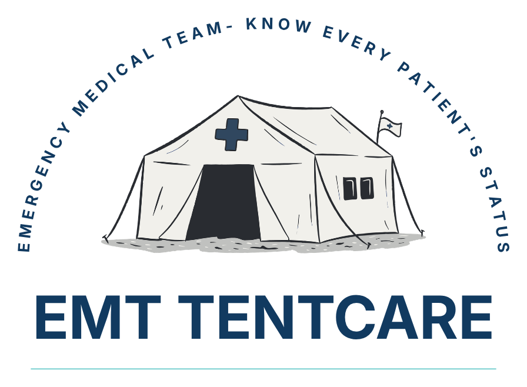
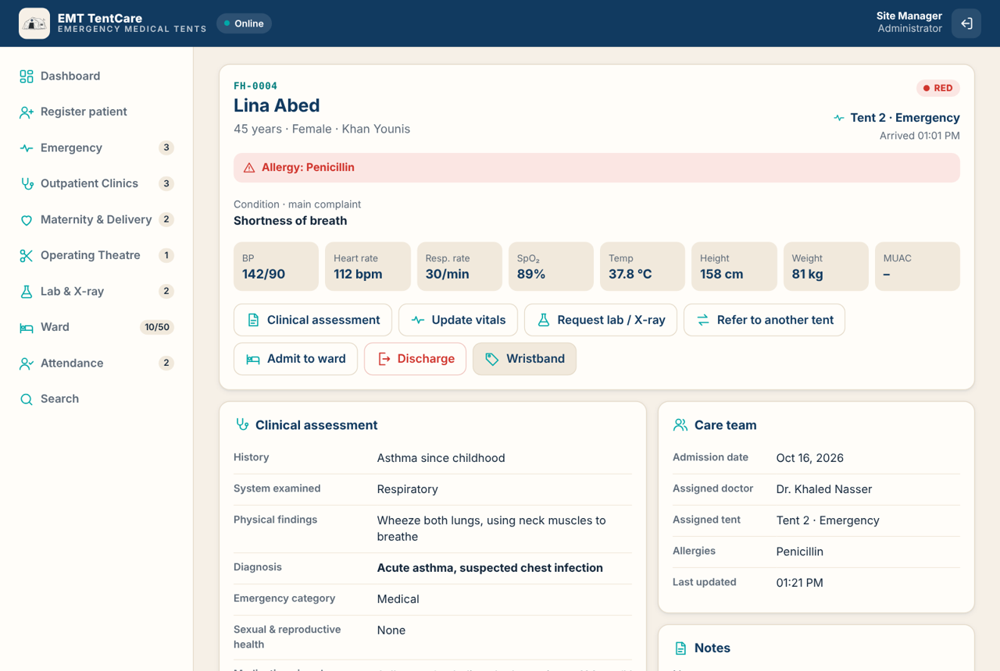
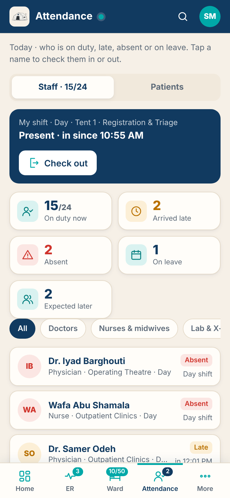
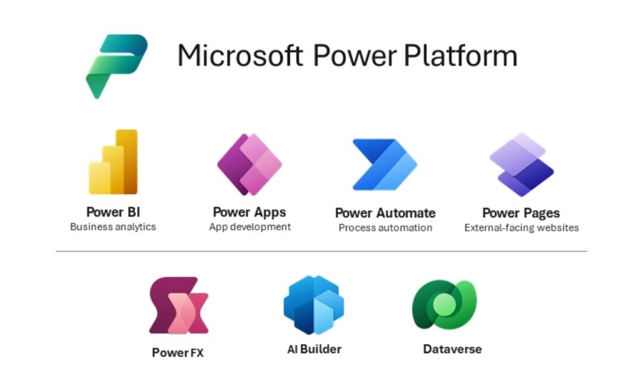
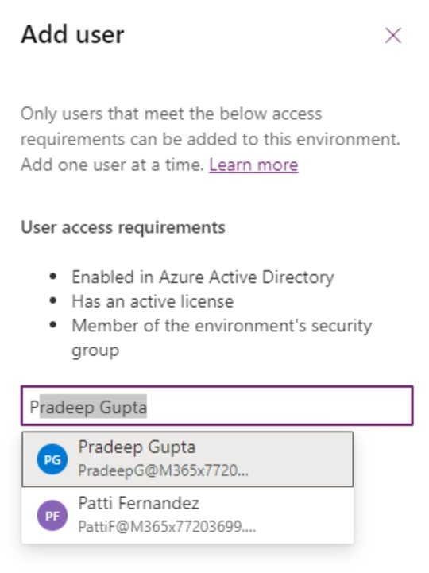
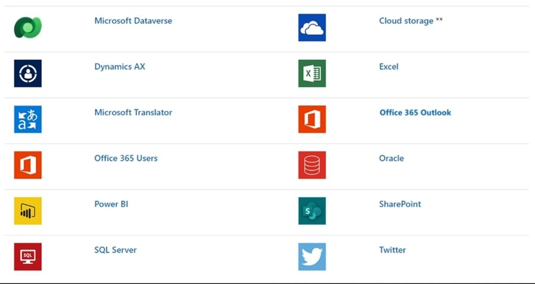
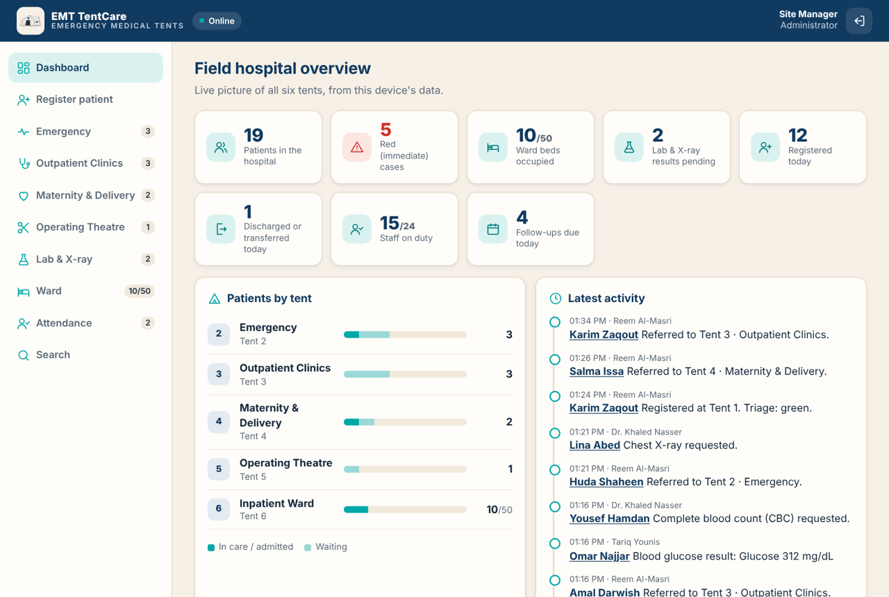

# EMT TentCare

Emergency medical tents: know every patient's status. A patient flow system for a six-tent field hospital, built to keep working when the internet doesn't.

**Try it:** https://mahassira.github.io/emergency-field-hospital/

I worked in Gaza with International Medical Corps when we set up a field hospital during the war. This is a demo of the kind of system I wish we'd had from day one: one patient file that follows the person from the registration tent to the ward.

## Demo accounts

All passwords are `demo123`.

| Work email | Role | What to try |
| --- | --- | --- |
| `reception@emttentcare.com` | Registration clerk | Register a patient, pick a triage colour, send them to a tent |
| `doctor@emttentcare.com` | Physician | See the queue, fill in the clinical assessment, order an X-ray, refer, admit, approve discharge |
| `lab@emttentcare.com` | Lab & X-ray | Enter results that go straight back to the patient's file |
| `nurse@emttentcare.com` | Ward nurse | 50-bed ward map, vitals and nursing notes, confirm a patient has left |
| `admin@emttentcare.com` | Site manager | Dashboard for the whole hospital, staff attendance, export everything to Excel |

## The tents

1. Registration & Triage
2. Emergency
3. Outpatient Clinics
4. Maternity & Delivery
5. Operating Theatre
6. Inpatient Ward (50 beds)

Plus a Lab & X-ray unit that serves all of them.

## The patient file

One file per patient, filled in by each tent along the way:

- **Registration and vitals:** admission date, name, age, gender (including pregnant), condition, allergies, blood pressure, heart rate, respiratory rate, oxygen saturation, temperature, height, weight and MUAC.
- **Clinical assessment:** history, system examined, physical findings, diagnosis, emergency category (trauma, medical, obstetric and so on), sexual and reproductive health services, medication given on site, procedures, blood transfusion and the patient's response.
- **Lab and imaging:** tests and X-ray or ultrasound requests, with results sent back to the file.
- **Outcome:** visit outcome, medication to take home, referral and referral note, outcome note and a follow-up date.
- **Care team:** assigned doctor, assigned tent and bed, and when the file was last updated.

## Attendance

 &nbsp; 

- **Staff:** doctors, nurses, midwives, lab staff, registration and support staff check in and out of their shift. The registration desk and the site manager see at a glance who is on duty, who arrived late, who is absent and who is on leave.
- **Patients:** who is in each tent right now, and which follow-up visits were attended or missed.

## Runs inside the Microsoft 365 environment

The full version is designed to run entirely inside the hospital's or organisation's own Microsoft 365 work environment. Nothing sits on an outside server: the app, the data and the reports all live in the organisation's own tenant, alongside the Microsoft tools staff already use.

**Sign in with the work email.** Staff use their Microsoft work account (Microsoft Entra ID). No separate usernames or passwords, and access ends automatically when someone leaves the organisation. Only people the IT team adds to the environment can open the app.

 &nbsp; 

**Security roles decide who does what.** Registration, doctor, lab, nurse and site manager are security roles in Microsoft Dataverse. A lab technician can enter results but cannot discharge a patient, and the manager sees everything.

**Every action recorded against a work email.** Each registration, assessment, test, referral, admission, discharge and staff check-in is stamped with the staff member's organisational email, so the patient file and the attendance record are a complete audit trail.

**Connected to the core Microsoft apps.**

| Microsoft app | What it does in TentCare |
| --- | --- |
| Dataverse | Database for patients, tests, beds, staff, attendance and the activity log |
| Outlook | Emails referral letters, follow-up reminders and the daily summary |
| Teams | Alerts the ward when a bed is needed or a red case arrives |
| SharePoint | Stores scanned documents, consent forms and X-ray images |
| Excel | Exports for the health cluster and donor reports |
| Power BI | Live dashboards for management: patients, beds, outcomes, staff attendance |
| Power Automate | Runs the alerts, reminders and approvals between them |
| Office 365 Users | Pulls each staff member's name, job title and manager from the directory |

**Still offline-first.** Tablets and phones keep working with no internet and sync to Dataverse when the connection comes back.

The live demo link above does not connect to Microsoft services. It saves everything on your own device.

## Offline

It installs on a phone or tablet like an app ("Add to Home Screen") and keeps working with no connection. Everything is saved on the device. In a real deployment, the export would sync to a central server when the network comes back.

## Built with

Plain HTML, CSS and JavaScript, a service worker for offline use.

---

Demo only. Every patient and staff member is fictional. Not a medical device, and not for real patient care.

© 2026 Mahassira. All rights reserved.
